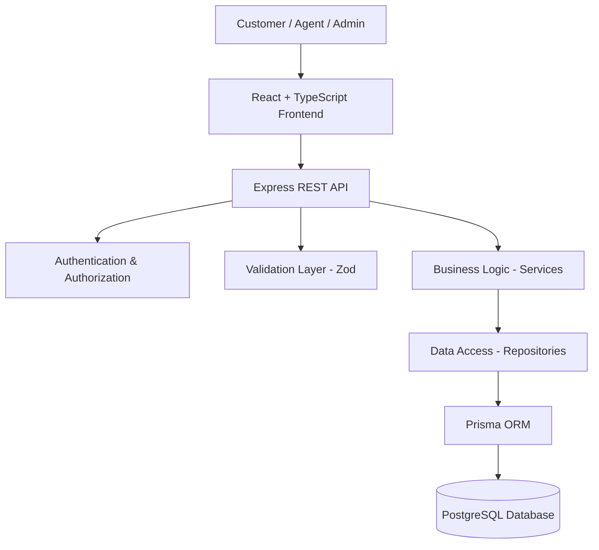

# SupportDesk — Customer Support & Ticket Management System

A full-stack customer support platform that helps organizations manage customer queries, assign tickets to support agents, track ticket progress, and monitor support operations through role-based dashboards.

## Live Demo

- **Frontend:** [Add deployed frontend URL]
- **Backend API:** [Add deployed backend URL]
- **GitHub:** [Add repository URL]

## Overview

SupportDesk is a role-based ticket management application designed around three user types: Admin, Agent, and Customer.

Customers can create and track support tickets, agents can manage assigned tickets and respond to queries, and administrators can manage agents and monitor overall support activity.

## Key Features

### Authentication & Authorization
- User registration and login
- JWT-based authentication
- Access token refresh mechanism
- Protected routes
- Role-based access control
- Secure logout

### Admin
- Admin dashboard with support statistics
- Agent management
- Ticket overview and management
- Ticket assignment

### Agent
- Agent dashboard
- View assigned tickets
- Update ticket status
- Respond through ticket comments

### Customer
- Create support tickets
- View ticket details
- Track ticket status
- Communicate through comments

### Ticket Management
- Unique ticket numbers
- Ticket priorities: Low, Medium, High, Urgent
- Ticket statuses: Open, In Progress, Resolved, Closed
- Ticket assignment
- Ticket comments and updates

## Technology Stack

| Layer | Technologies |
|---|---|
| Frontend | React, TypeScript |
| Styling | Tailwind CSS |
| Backend | Node.js, Express.js |
| Database | PostgreSQL |
| ORM | Prisma |
| Validation | Zod |
| Authentication | JWT |
| Development | Docker, Git, GitHub |

## System Architecture



## Project Structure

```text
SupportDesk/
├── client/
│   └── src/
│       ├── components/
│       ├── contexts/
│       ├── pages/
│       ├── routes/
│       ├── services/
│       └── ...
│
├── server/
│   ├── prisma/
│   ├── src/
│   │   ├── controllers/
│   │   ├── middleware/
│   │   ├── repositories/
│   │   ├── routes/
│   │   ├── services/
│   │   └── ...
│   ├── tests/
│   └── integration-tests/
│
└── README.md
```

Adjust the folder names if they differ from the final repository.

## Getting Started

### Prerequisites
- Node.js
- PostgreSQL or Docker
- npm

### Installation

Clone the repository:

```bash
git clone YOUR_GITHUB_REPOSITORY_URL
cd SupportDesk
```

Install frontend dependencies:

```bash
cd client
npm install
```

Install backend dependencies:

```bash
cd ../server
npm install
```

### Environment Configuration

Configure the environment variables required by the frontend and backend.

Typical backend configuration includes:

```env
DATABASE_URL=
JWT_ACCESS_SECRET=
CLIENT_URL=
```

Add any other secrets and configuration required by the actual implementation. Never commit real credentials.

### Database Setup

Configure PostgreSQL and run the project's Prisma migrations using the commands defined in the backend configuration.

### Run the Application

Start the backend and frontend using their respective development scripts.

## Testing

The project includes:
- Backend service tests
- API route tests
- Validation tests
- Integration tests

Run the relevant test scripts from the server directory.

## Future Enhancements

- Email notifications
- Real-time ticket updates
- File attachments
- Advanced reporting and analytics
- Ticket search and filtering enhancements

## Author

**Jaswanth Chunduri**

Full-Stack Developer | React | TypeScript | Node.js | PostgreSQL
